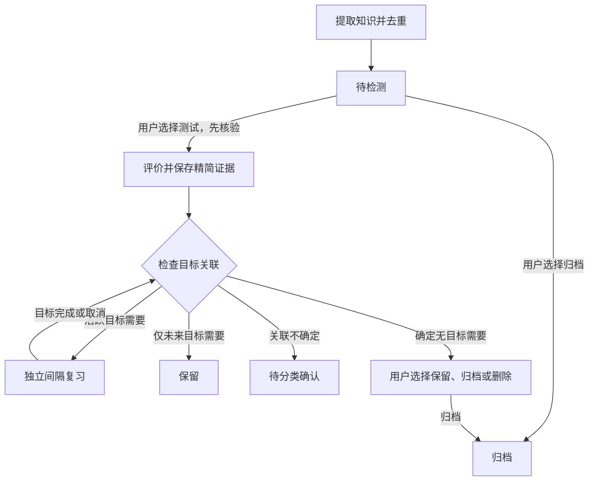

# 知识生命周期

一个知识一份现行KP记录，ID从待检测阶段开始稳定。不同板块是状态视图，不复制知识。



## 状态维度

- verification：needs_validation/verified，教学评分依据是否核验。
- assessment：untested/tested，是否完成诊断，和答对答错无关。
- availability：active/archived，是否允许安排学习。
- goal_links：目标ID、关系、版本化大纲ID、章节、匹配理由、重要性及适用性；允许多个。
- mastery/evidence：具体维度的表现与精简证据。
- schedule：每个KP范围独立的ladder-v2状态。
- routing：派生的intake/review/retained/classification_pending/decision_required/archived。

未测知识先处于intake，即使暂时不知道目标关系也能由用户主动诊断。测试后有关联才安排复习。unknown和partial保留原结果，需补充评价；不能未经判断当成wrong自动降级。未答、skip不改变掌握或复习日期。

## 目标关联和完成

直接要求或必要基础需有版本化大纲/个人目标要求及章节。脚本校验引用存在，不替代助手对内容的语义核对。没有匹配记录、适用性未确认或关系uncertain都视作未完成分类，不生成删除建议。重要性未知用null，不臆造考频。

关闭目标时保留历史关联，重算所有引用。其他活跃目标需要则继续复习；未来目标需要则保留；不确定则待分类；无任何未关闭目标需要才询问归档、兴趣保留或删除。保留为兴趣默认不自动复习，需要长期维护时可建立明确的个人目标要求。

重检不产生新测验、不改证据和schedule。新增目标、目标重新启用或大纲变化后要重新核对关联并刷新视图；大纲版本变更不能直接沿用旧版“无关”结论。

## 入口与写入

以下命令默认预览，变更类加--write才写本地；之后由助手原子提交GitHub。日期由调用方按Asia/Shanghai提供。

```sh
python scripts/learning.py --day 2026-10-12
python scripts/learning.py --day 2026-10-12 --mode diagnose --new-limit 2
python scripts/lifecycle.py --day 2026-10-12 intake KP-EXAMPLE --title '知识范围' --source SRC-EXAMPLE
python scripts/lifecycle.py --day 2026-10-12 verify KP-EXAMPLE --basis '已核验的教材或权威来源'
python scripts/lifecycle.py --day 2026-10-12 evaluate KP-EXAMPLE /tmp/compact-event.json
python scripts/lifecycle.py --day 2026-10-12 match KP-EXAMPLE G-UPGRADE direct --basis '逐项核对理由' --syllabus JX-ZSB-2026 --section EN-KNOWLEDGE
python scripts/lifecycle.py --day 2026-10-12 close-goal G-UPGRADE
python scripts/lifecycle.py --day 2026-10-12 decide KP-EXAMPLE archive --reason '用户选择归档'
python scripts/lifecycle.py --day 2026-10-12 decide KP-EXAMPLE restore --reason '用户要求恢复'
python scripts/lifecycle.py --day 2026-10-12 decide KP-EXAMPLE retain_interest
python scripts/lifecycle.py --day 2026-10-12 decide KP-EXAMPLE delete_proposal
python scripts/lifecycle.py --day 2026-10-12 recheck --write
python scripts/catalogue.py --validate
```

上面的KP-EXAMPLE是示例，实际使用已有ID。新建前按内容检索去重，不能只凭标题不同就建重复知识。新增记录同步生成目录节点；尚未确定学科模块时可暂留根级，随后整理归属。

删除建议展示具体知识路径、索引引用和共享来源，默认只读。删除须用户明确选择；助手届时检查依赖、清理本知识的精简证据及引用，不删除共享来源中其他知识或生活数据。Git历史不自动清除。

## 迁移事实与边界

原161个资料ID保留为legacy_source历史快照，现行知识由原253个可评价范围加24个历史补录范围构成。它们并非全部已核验的最小知识点；广泛能力范围仍可继续细分。

仅47个实际被测范围拥有历史诊断证据，总计53份范围评价、19次诊断。只为这些范围继承对应旧日期；未测子项没有到期日，不继承父模块掌握程度。独立性与维度未知的历史证据保持未知。原调度快照保存在knowledge/migrations/，不参与派题。

生活数据和报告不参与此次迁移。C/Shell原73条资料对应的119个范围保持归档。24条计算机历史补录仅进入待检测，原学习日期未知，不产生历史复习债务。
